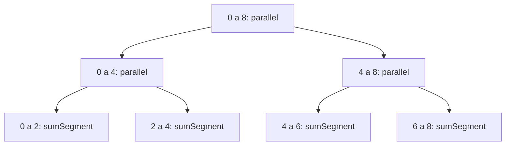
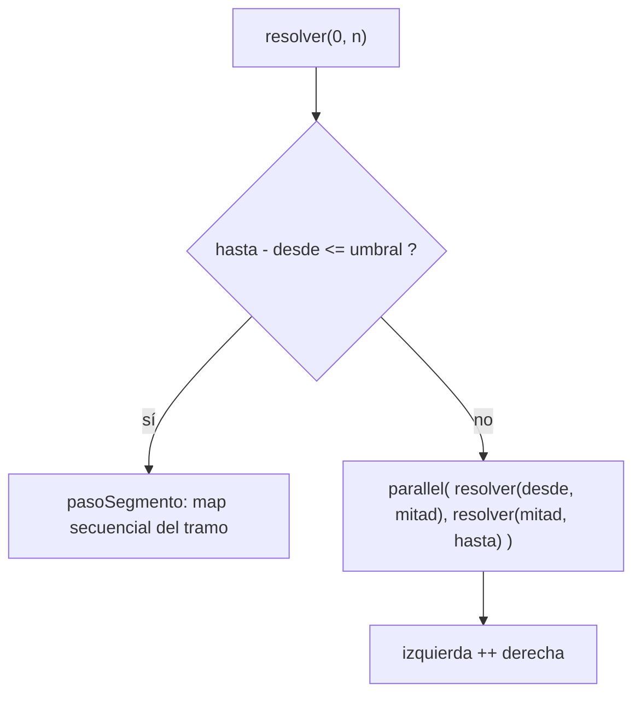

# Suma de potencias sobre un arreglo, repartida con `parallel`

## El cálculo

`sumSegment` recorre un tramo del arreglo y acumula la potencia `p` de cada
elemento. Es una recursión de cola con acumulador.

```Scala
def power(x: Int, p: Double): Double =
  math.pow(math.abs(x.toDouble), p)

def sumSegment(a: Array[Int], p: Double, s: Int, t: Int): Double = {
  def aux(i: Int, acc: Double): Double =
    if (i >= t) acc
    else aux(i + 1, acc + power(a(i), p))
  aux(s, 0.0)
}
```

En notación matemática, con el tramo entre `s` incluido y `t` excluido:

```math
\text{sumSegment}(a, p, s, t) = \sum_{i=s}^{t-1} |a_i|^{\,p}
```

Sobre ese cálculo hay dos versiones que dividen el tramo a la mitad mientras
pase del umbral. La diferencia entre las dos es una línea: dónde una resuelve
las dos mitades una tras otra, la otra las entrega a `parallel`.

```Scala
def segmentRecSec(a: Array[Int], p: Double, s: Int, t: Int, umbral: Int): Double =
  if (t - s <= umbral) sumSegment(a, p, s, t)
  else {
    val m = s + (t - s) / 2
    val sum1 = segmentRecSec(a, p, s, m, umbral)
    val sum2 = segmentRecSec(a, p, m, t, umbral)
    sum1 + sum2
  }

def segmentRecPar(a: Array[Int], p: Double, s: Int, t: Int, umbral: Int): Double =
  if (t - s <= umbral) sumSegment(a, p, s, t)
  else {
    val m = s + (t - s) / 2
    val (sum1, sum2) = parallel(
      segmentRecPar(a, p, s, m, umbral),
      segmentRecPar(a, p, m, t, umbral))
    sum1 + sum2
  }
```

## La estrategia de reparto

El tramo se parte por la mitad en `m`, y cada mitad se resuelve sin mirar la
otra: ningún índice aparece en las dos y ninguno se queda por fuera, porque un
tramo va de `s` a `m` y el otro de `m` a `t`. Por debajo del umbral ya no se
parte y el tramo se resuelve con `sumSegment`.

Lo que combina los resultados parciales es la suma, y la suma es asociativa:

```math
\left(\sum_{i=s}^{m-1} |a_i|^{\,p}\right) + \left(\sum_{i=m}^{t-1} |a_i|^{\,p}\right)
= \sum_{i=s}^{t-1} |a_i|^{\,p}
```

Por eso el orden en que terminen las dos mitades no cambia el resultado, y por
eso se pueden repartir. El árbol de llamados para un arreglo de ocho elementos
con umbral 2 queda así, con las hojas resolviendo en secuencial:



## Cómo se tomaron los tiempos

Cada cifra sale de ScalaMeter, la librería con que mide el curso:
`withWarmer(new Warmer.Default) measure { ... }` ejecuta el bloque hasta que la
máquina virtual se estabiliza y solo entonces mide, porque las primeras
corridas miden una versión del programa que el compilador interno todavía está
optimizando. Cada tiempo es la mediana de cinco mediciones y al lado va la
desviación de esas cinco, que dice cuánto se movió el reloj de una a otra.

```Scala
import org.scalameter._

def medir[A](repeticiones: Int)(cuerpo: => A): Double = {
  val muestras = Vector.fill(repeticiones) {
    (withWarmer(new Warmer.Default) measure { cuerpo }).value
  }
  muestras.sorted.apply(muestras.length / 2)
}

def desviacion(ts: List[Double]): Double = {
  val media = ts.sum / ts.size
  math.sqrt(ts.map(t => (t - media) * (t - media)).sum / ts.size)
}
```

La dependencia ya viene en `app/build.gradle` del repositorio:

```groovy
implementation 'com.storm-enroute:scalameter-core_2.13:0.21'
```

Las dos versiones recorren el arreglo con la misma función, así que la
diferencia de tiempos es la del reparto. La medición con el umbral igual al
tamaño del arreglo sirve de control: ahí `segmentRecPar` no parte nada y su
tiempo tiene que ser el de `segmentRecSec`.

La máquina tiene 16 núcleos. Los arreglos llevan enteros entre 1 y 100, la
potencia que se suma es 2 y los tiempos están en milisegundos.

## Las mediciones

Con el umbral fijo en 1024, según el tamaño del arreglo:

| n | Secuencial | Desv. | Paralela | Desv. | Aceleración |
|---:|---:|---:|---:|---:|---:|
| 100 000 | 0,5 | 0,3 | 0,4 | 0,1 | 1,43 |
| 1 000 000 | 2,4 | 0,1 | 1,0 | 0,1 | 2,30 |
| 5 000 000 | 12,2 | 0,2 | 2,4 | 0,1 | 5,11 |
| 20 000 000 | 48,7 | 1,0 | 8,3 | 0,3 | 5,84 |

Con el arreglo fijo en 5 000 000 de elementos, según el umbral. La última
columna es la aceleración que predice la estimación de trabajo y profundidad,
calculada como el trabajo total dividido entre el tiempo estimado para 16
núcleos:

| Umbral | Particiones | Paralela | Desv. | Aceleración | Aceleración estimada |
|---:|---:|---:|---:|---:|---:|
| 5 000 000 | 0 | 12,4 | 0,2 | 0,98 | 0,94 |
| 1 250 000 | 2 | 3,3 | 0,1 | 3,73 | 3,20 |
| 312 500 | 4 | 2,2 | 0,1 | 5,54 | 8,00 |
| 78 125 | 6 | 1,9 | 0,1 | **6,45** | 12,80 |
| 19 531 | 9 | 2,1 | 0,1 | 5,76 | 15,51 |
| 4 883 | 10 | 2,2 | 0,1 | 5,46 | 15,75 |
| 1 024 | 13 | 2,2 | 0,0 | 5,45 | 15,97 |
| 256 | 15 | 2,2 | 1,0 | 5,56 | 15,99 |

El tiempo secuencial de referencia de esta segunda tabla es 12,2 ms, con
desviación 0,1.

Las dos tablas salen de corridas distintas, y por eso la fila de 5 000 000 con
umbral 1024 da 2,4 ms en la primera y 2,2 ms en la segunda. Esas dos décimas
son el ruido de la medida, y hay que tenerlas presentes al comparar dos filas
parecidas.

## Lo que dicen los números

El control responde lo que debía: con umbral 5 000 000 la aceleración es 0,98,
el mismo tiempo de la versión secuencial. Una cifra bastante mayor que 1 en esa
fila diría que las dos versiones no están haciendo el mismo trabajo y que la
comparación no mide el reparto.

Repartir paga cuando hay con qué pagarlo. Con 100 000 elementos la aceleración
apenas llega a 1,43 y el arreglo entero se recorre en medio milisegundo: crear
los llamados cuesta casi tanto como el cálculo. A 5 000 000 la aceleración sube
a 5,11, y a 20 000 000 a 5,84.

El umbral que más conviene no es el más pequeño. El mejor tiempo está en
78 125, que son seis particiones y 64 tramos para 16 núcleos. De 19 531 hacia
abajo la aceleración baja a 5,5 y se queda ahí: cada partición agrega dos
llamados que hay que repartir, y por debajo de cierto tamaño ese costo ya no se
recupera con el tramo que se ahorra.

La estimación del punto 4 y la medición coinciden donde no se parte nada y se
separan en cuanto se parte. En la fila de control las dos dan 1. De ahí en
adelante la estimación crece hasta 15,99 mientras la medición se queda en 6,45.
La estimación cuenta operaciones y supone que los 16 núcleos están siempre
ocupados y que crear un llamado no cuesta nada; el reloj incluye el costo de
repartir, el acceso a una memoria que comparten todos los núcleos y lo que la
máquina esté haciendo al lado. Sirve como techo y para comparar umbrales entre
sí, no como pronóstico del reloj.

Con la aceleración medida de 6,45 sobre 16 núcleos, la ley de Amdahl da la
fracción del cálculo que corre en serie, con p el número de núcleos:

```math
S(p) = \frac{1}{f + \frac{1 - f}{p}}
\qquad\Longrightarrow\qquad
f = \frac{\frac{1}{S} - \frac{1}{p}}{1 - \frac{1}{p}} = 0{,}099
```

Un décimo del cálculo corre en serie, y con ese décimo el techo es 10 por
muchos núcleos que se agreguen:

| p | 2 | 4 | 8 | 16 | 32 | ∞ |
|---|---:|---:|---:|---:|---:|---:|
| Aceleración máxima | 1,82 | 3,09 | 4,73 | 6,45 | 7,88 | 10,1 |

Pasar de 16 a 32 núcleos agregaría 1,4 a la aceleración, menos de lo que se
ganó entre 4 y 8. En este cálculo esa décima parte está en partir el arreglo y
combinar los resultados, y en el acceso a una memoria que comparten los
dieciséis núcleos.

# Informe de paralelización — Taller 4: simulación de partículas
 
> **Antes de entregar:** las celdas marcadas con `—` y los textos entre
> corchetes `[ ... ]` son datos que salen de **su** máquina al ejecutar
> `./gradlew run` (punto 5). Complételos con los números reales y borre esta
> nota. No se deben inventar tiempos: la rúbrica pide los que produce
> `App.scala`.
 
## 1. La estrategia de reparto
 
**Dónde se reparte.** El paso de la simulación (`pasoParalelo`, punto 1) es
el problema ideal para repartir: la partícula $i$ nueva depende solo de la
partícula $i$ vieja y de `dt`, nunca de las demás. Por eso los tramos del
arreglo se pueden calcular al mismo tiempo sin coordinarse.
 
**Con qué abstracción.** Con `parallel(a, b)` del paquete `common`, que
calcula dos expresiones a la vez y devuelve el par de resultados. No se usa
`task` ni ningún otro mecanismo.
 
**Con qué criterio se deja de partir.** La función interna
`resolver(desde, hasta)` parte el tramo por la mitad mientras tenga **más**
elementos que el umbral. Por debajo de esa cifra resuelve el tramo en
secuencial con `pasoSegmento`. El umbral se toma como mínimo 1 para que la
recursión siempre termine.
 

 
**Qué operación combina los resultados parciales.** La concatenación `++` de
las dos mitades, con la izquierda primero. Es asociativa, así que el
resultado no depende de cómo quede agrupado el árbol de llamados (la
demostración está en `correccion.md`, sección 1.7). Como cada partícula se
mueve exactamente una vez con las mismas operaciones, `pasoParalelo` da
**exactamente** lo mismo que `pasoSecuencial`.
 
**Qué no se reparte.** Las magnitudes del punto 2 (`energiaSecuencial`,
`masaTotal`, `centroDeMasaSecuencial`) son secuenciales. Su versión repartida
es el punto 3.
 
**Cuidado con la comparación justa.** `pasoSecuencial` es
`pasoSegmento(s, dt, 0, s.length)` y `pasoParalelo` usa `pasoSegmento` en las
hojas. Las dos recorren el arreglo con `slice` y `map`, así que la diferencia
de tiempos mide el costo del reparto y no el de dos operaciones distintas.
 
## 2. La tabla de tiempos
 
Máquina donde se midió: **[modelo del procesador]**.
Núcleos disponibles: **[el valor que imprime `App.scala` en
`Núcleos disponibles`]**.
 
Los tiempos son la mediana de varias corridas en milisegundos, tomada con
`medir` después de una corrida de calentamiento. La aceleración es
$\text{aceleración} = t_{\text{secuencial}} / t_{\text{paralelo}}$.
 
| Partículas $n$ | Umbral | $t_{\text{sec}}$ (ms) | $t_{\text{par}}$ (ms) | Aceleración |
|---:|---:|---:|---:|---:|
| 1 000 000 | 1 000 | — | — | — |
| 1 000 000 | 10 000 | — | — | — |
| 1 000 000 | 100 000 | — | — | — |
| 1 000 000 | **1 000 000 (control)** | — | — | **1.0** |
| 2 000 000 | 1 000 | — | — | — |
| 2 000 000 | 10 000 | — | — | — |
| 2 000 000 | 100 000 | — | — | — |
| 2 000 000 | **2 000 000 (control)** | — | — | **1.0** |
| 4 000 000 | 1 000 | — | — | — |
| 4 000 000 | 10 000 | — | — | — |
| 4 000 000 | 100 000 | — | — | — |
| 4 000 000 | **4 000 000 (control)** | — | — | **1.0** |
 
**La fila de control.** Con el umbral igual al tamaño del sistema,
`pasoParalelo` no parte nada y hace exactamente el mismo trabajo que
`pasoSecuencial`. Por eso la aceleración tiene que dar 1 (con el ruido normal
de una medición). Si da claramente distinto de 1, la comparación no es justa y
hay que revisar que las dos versiones hagan el mismo trabajo de la misma forma.
 
Los tamaños son de al menos un millón de partículas: con unos pocos miles, el
reparto cuesta más de lo que ahorra.
 
## 3. Comparación con la estimación del punto 4
 
El punto 4 estima el costo sin ejecutar nada:
 
```math
\text{trabajo}(n) = n \qquad
\text{tiempoEstimado}(n, p, \text{umbral}) = \text{profundidad}(n, \text{umbral}) + \frac{\text{trabajo}(n)}{p}
```
 
donde $p$ es el número de núcleos y la profundidad es el número de veces que
se parte a la mitad hasta llegar al umbral, más el trabajo del tramo que queda
sin partir.
 
| $n$ | Umbral | Aceleración estimada $\dfrac{n}{\text{tiempoEstimado}}$ | Aceleración medida |
|---:|---:|---:|---:|
| 1 000 000 | 10 000 | — | — |
| 1 000 000 | 100 000 | — | — |
| 4 000 000 | 10 000 | — | — |
 
(La aceleración estimada se calcula con las funciones del punto 4, tomando
$\text{trabajo}(n)$ como el tiempo secuencial.)
 
**En qué se parecen.** [Describa lo que vea en sus números. Por ejemplo: en
los dos la aceleración sube cuando aumentan los núcleos y se acerca a un
tope; y un umbral muy grande deja núcleos sin trabajo tanto en la estimación
como en la medición.]
 
**En qué no se parecen y a qué lo atribuye.** [Describa la diferencia que vea
y atribúyala. La estimación cuenta una operación por partícula y supone que
repartir no cuesta nada. Lo medido incluye costos que el modelo no tiene.
Conserve solo los que correspondan a sus números:]
 
- **Crear y esperar tareas:** cada `parallel` cuesta tiempo, y con umbrales
  pequeños hay muchísimas tareas.
- **Copiar arreglos:** cada `++` crea un arreglo nuevo y copia las dos mitades,
  trabajo que la versión secuencial no hace.
- **Memoria:** mover una partícula son pocas operaciones, así que el tiempo lo
  domina leer y escribir en memoria, que los núcleos comparten.
- **Recolector de basura y compilador de la máquina virtual:** crean ruido y
  trabajo extra que el modelo no considera.
## 4. Lectura de los resultados
 
**Qué umbral resultó conveniente y por qué.** [Diga cuál umbral de la tabla
dio la mayor aceleración, y explique la razón: con un umbral muy pequeño hay
demasiadas tareas y el reparto cuesta más de lo que ahorra; con un umbral muy
grande hay pocas tareas y se dejan núcleos sin trabajo. El conveniente queda en
el medio. `umbralConveniente` hace esta búsqueda de forma automática.]
 
**Por qué la aceleración deja de crecer aunque se agreguen núcleos.** Una
parte del cálculo no se reparte: crear el arreglo resultante, copiar al
concatenar y el recorrido inicial. Si $f$ es la fracción del cálculo que sí se
reparte, con $p$ núcleos la aceleración es como máximo:
 
```math
S(p) = \frac{1}{(1 - f) + \dfrac{f}{p}}
```
 
y aunque $p$ crezca sin límite, $S$ nunca pasa de $\dfrac{1}{1 - f}$. Esa es la
ley de Amdahl: lo que no se reparte fija el techo.
 
**Fracción del cálculo que no se reparte.** A partir de la aceleración medida
$S$ y del número de núcleos $p$, la fracción $s = 1 - f$ que no se reparte es:
 
```math
s = \frac{\dfrac{1}{S} - \dfrac{1}{p}}{1 - \dfrac{1}{p}}
```
 
Con la mejor aceleración medida $S = [\ \ ]$ y $p = [\ \ ]$ núcleos:
$s = [\ \ ]$, es decir, cerca del $[\ \ ]\,\%$ del cálculo no se reparte, y la
aceleración no puede pasar de $1/s = [\ \ ]$ por más núcleos que se agreguen.
 