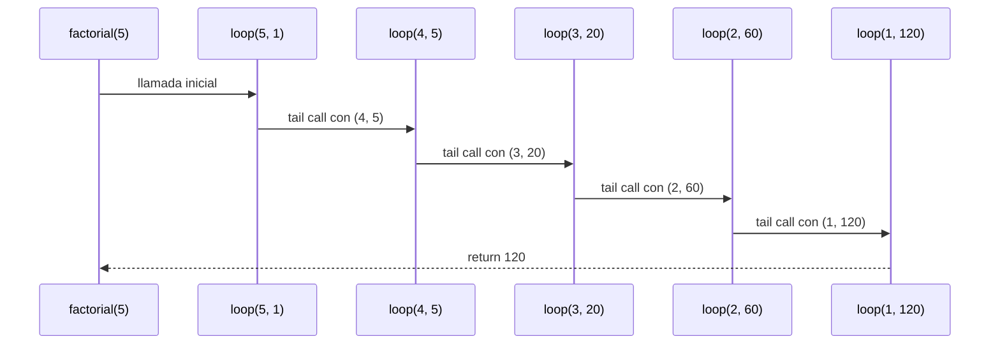
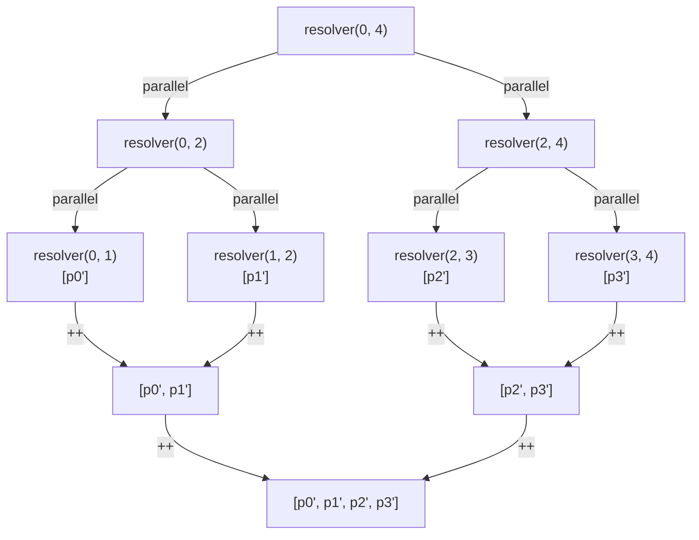
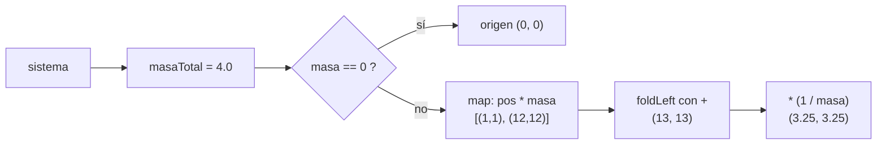

# Algoritmo Factorial con Recursión de Cola

## Definición del Algoritmo

```Scala
def factorial(n: Int): BigInt = {
  @annotation.tailrec
  def loop(x: Int, acumulador: BigInt): BigInt = {
    if (x <= 1) acumulador
    else loop(x - 1, acumulador * x)
  }
  loop(n, 1)
}
```

* La función `factorial` calcula el factorial de un número `n` utilizando **recursión de cola**.
* La función interna `loop` es la que hace la recursión:

  * Recibe dos parámetros:

    * `x`: el valor actual decreciente hasta llegar a 1.
    * `acumulador`: donde se guarda el resultado parcial en cada paso.
* El decorador `@annotation.tailrec` obliga a que la función sea optimizada como recursión de cola, es decir, **no se acumulan llamados en la pila**.

## Explicación paso a paso

### Caso base

```Scala
if (x <= 1) acumulador
```

Cuando `x` llega a `1`, la función retorna directamente el valor acumulado, evitando más llamadas.

### Caso recursivo

```Scala
loop(x - 1, acumulador * x)
```

En cada llamada:

* Se reduce el valor de `x` en 1.
* Se multiplica el acumulador por `x` y se pasa a la siguiente iteración.
* Como es recursión de cola, la llamada recursiva es la **última instrucción** en ejecutarse, lo que permite a Scala optimizar la pila.

---

## Llamados de pila en recursión de cola

Ejemplo:

```Scala
factorial(5)
```

### Paso 1: Llamada inicial

```Scala
loop(5, 1)
```

### Paso 2: Primera iteración

```Scala
loop(4, 5)   // acumulador = 1 * 5
```

### Paso 3: Segunda iteración

```Scala
loop(3, 20)  // acumulador = 5 * 4
```

### Paso 4: Tercera iteración

```Scala
loop(2, 60)  // acumulador = 20 * 3
```

### Paso 5: Cuarta iteración

```Scala
loop(1, 120) // acumulador = 60 * 2
```

### Paso 6: Caso base

```Scala
return 120
```

---

## Diferencia con recursión normal

* En **recursión normal** cada llamada queda en la pila esperando a que termine la siguiente, lo que puede causar desbordamiento si `n` es muy grande.
* En **recursión de cola**, el compilador transforma el proceso en un **bucle optimizado**, por lo que no se guarda cada llamada en la pila y el algoritmo puede ejecutarse para valores muy grandes sin problema.

---

## Ejemplo de uso

```Scala
val resultado = factorial(5)
println(resultado)  // 120
```

El resultado de `factorial(5)` es `120`.


## Diagrama de llamados de pila con recursión de cola


# Informe de proceso — Taller 4: simulación de partículas
 
Este informe explica, paso a paso, cómo se ejecuta cada función de los
puntos 1 y 2: un paso de la simulación y las magnitudes globales
(secuenciales). Cada función se sigue con un ejemplo pequeño y la traza de
sus llamados. En las funciones repartidas se indica qué tramo resuelve cada
llamado y cómo se combinan los resultados parciales.
 
## 0. Los datos
 
```scala
case class Vector2(x: Double, y: Double)   // con +, * (por un número) y norma
case class Particula(pos: Vector2, vel: Vector2, masa: Double)
type Sistema = Array[Particula]
```
 
Un `Sistema` es un arreglo de partículas. Ninguna función lo modifica:
todas devuelven un arreglo nuevo o un número.
 
---
 
## 1. Punto 1: un paso de la simulación
 
### 1.1 `mover`
 
```scala
def mover(p: Particula, dt: Double): Particula =
  Particula(p.pos + p.vel * dt, p.vel, p.masa)
```
 
Mueve **una** partícula: la posición nueva es la anterior más la velocidad
por `dt`. La velocidad y la masa se copian sin cambios.
 
### 1.2 `pasoSegmento`
 
```scala
def pasoSegmento(s: Sistema, dt: Double, desde: Int, hasta: Int): Sistema =
  s.slice(desde, hasta).map(p => mover(p, dt))
```
 
1. `s.slice(desde, hasta)` toma el tramo desde `desde` (incluido) hasta
   `hasta` (excluido).
2. `map` aplica `mover` a cada partícula del tramo.
3. El resultado es un arreglo con **solo** las partículas del tramo, ya
   movidas y en el mismo orden.
### 1.3 `pasoSecuencial`
 
```scala
def pasoSecuencial(s: Sistema, dt: Double): Sistema =
  pasoSegmento(s, dt, 0, s.length)
```
 
Es el segmento que va desde 0 hasta el final: todo el sistema en un solo
tramo. Se hace así a propósito, para que la versión secuencial y la paralela
hagan el mismo trabajo de la misma forma.
 
### 1.4 `pasoParalelo`
 
```scala
def pasoParalelo(s: Sistema, dt: Double, umbral: Int): Sistema = {
  val limite = Math.max(umbral, 1)
 
  def resolver(desde: Int, hasta: Int): Sistema =
    if (hasta - desde <= limite) {
      pasoSegmento(s, dt, desde, hasta)
    } else {
      val mitad = desde + (hasta - desde) / 2
      val (izquierda, derecha) = parallel(
        resolver(desde, mitad),
        resolver(mitad, hasta))
      izquierda ++ derecha
    }
 
  resolver(0, s.length)
}
```
 
- `limite` es el umbral, pero nunca menor que 1. Con un umbral de 0 o
  negativo, un tramo de un elemento se partiría para siempre.
- `resolver(desde, hasta)` resuelve el tramo `[desde, hasta)`:
  - **Tramo pequeño** (tiene `limite` elementos o menos): se resuelve en
    secuencial con `pasoSegmento`.
  - **Tramo grande**: se calcula la `mitad`, se resuelven las dos mitades **al
    mismo tiempo** con `parallel`, y se pegan con `++` en el mismo orden
    (izquierda primero).
- La primera llamada es `resolver(0, s.length)`, el sistema completo.
### 1.5 Ejemplo y traza
 
Cuatro partículas con masa 1, `dt = 2.0`:
 
| Partícula | `pos` | `vel` | `pos` nueva = `pos + vel * 2` |
|---|---|---|---|
| p0 | (0, 0) | (1, 0) | (2, 0) |
| p1 | (1, 0) | (0, 1) | (1, 2) |
| p2 | (2, 0) | (1, 1) | (4, 2) |
| p3 | (3, 0) | (2, 0) | (7, 0) |
 
**`pasoSecuencial(s, 2.0)`**: un solo llamado, `pasoSegmento(s, 2.0, 0, 4)`,
que mueve las cuatro partículas en orden y devuelve
`[p0', p1', p2', p3']`.
 
**`pasoParalelo(s, 2.0, 1)`**: aquí `limite = 1`. La traza de los llamados es:
 
```text
resolver(0, 4)   4 elementos > 1  -> mitad = 2 -> parallel( resolver(0, 2), resolver(2, 4) )
  resolver(0, 2) 2 elementos > 1  -> mitad = 1 -> parallel( resolver(0, 1), resolver(1, 2) )
    resolver(0, 1) 1 elemento <= 1 -> pasoSegmento(s, 2.0, 0, 1) = [p0']
    resolver(1, 2) 1 elemento <= 1 -> pasoSegmento(s, 2.0, 1, 2) = [p1']
    se combinan: [p0'] ++ [p1'] = [p0', p1']
  resolver(2, 4) 2 elementos > 1  -> mitad = 3 -> parallel( resolver(2, 3), resolver(3, 4) )
    resolver(2, 3) 1 elemento <= 1 -> pasoSegmento(s, 2.0, 2, 3) = [p2']
    resolver(3, 4) 1 elemento <= 1 -> pasoSegmento(s, 2.0, 3, 4) = [p3']
    se combinan: [p2'] ++ [p3'] = [p2', p3']
  se combinan: [p0', p1'] ++ [p2', p3'] = [p0', p1', p2', p3']
```
 
El resultado es el mismo que el del paso secuencial.
 

 
**Con `umbral = 2`** sobre las mismas cuatro partículas, `resolver(0, 4)` se
parte en `resolver(0, 2)` y `resolver(2, 4)`. Cada uno tiene 2 elementos, que
no superan el límite, así que cada uno se resuelve con un solo `pasoSegmento`
y no se parten más. Se hacen menos particiones.
 
**Con un número impar de partículas**, por ejemplo 5 y umbral 1, la mitad
sale de la división entera: `resolver(0, 5)` usa `mitad = 2` y queda
`resolver(0, 2)` (2 partículas) y `resolver(2, 5)` (3 partículas). Las dos
mitades no tienen que ser del mismo tamaño; lo importante es que juntas
cubren todo el tramo.
 
**Con el sistema vacío**, `resolver(0, 0)` tiene 0 elementos, que no superan
el límite, así que devuelve un arreglo vacío.
 
---
 
## 2. Punto 2: magnitudes globales
 
Ejemplo para esta sección, con dos partículas:
 
| Partícula | `pos` | `vel` | `masa` |
|---|---|---|---|
| A | (1, 1) | (6, 8) | 1.0 |
| B | (4, 4) | (0, 3) | 3.0 |
 
### 2.1 `energiaSecuencial`
 
```scala
def energiaSecuencial(s: Sistema): Double = {
  def energiaDe(p: Particula): Double =
    0.5 * p.masa * p.vel.norma * p.vel.norma
 
  s.map(p => energiaDe(p)).sum
}
```
 
1. `map` convierte cada partícula en su energía cinética, media masa por la
   norma de la velocidad al cuadrado.
2. `sum` suma todas las energías. En un sistema vacío la suma es `0.0`.
Traza con el ejemplo:
 
```text
energiaDe(A) = 0.5 * 1.0 * 10 * 10 = 50.0      (norma de (6, 8) = 10)
energiaDe(B) = 0.5 * 3.0 *  3 *  3 = 13.5      (norma de (0, 3) = 3)
map  -> [50.0, 13.5]
sum  -> 63.5
```
 
### 2.2 `masaTotal`
 
```scala
def masaTotal(s: Sistema): Double =
  s.map(p => p.masa).sum
```
 
Se toma la masa de cada partícula y se suman. Con el ejemplo:
`[1.0, 3.0]` y la suma es `4.0`. En un sistema vacío da `0.0`.
 
### 2.3 `centroDeMasaSecuencial`
 
```scala
def centroDeMasaSecuencial(s: Sistema): Vector2 = {
  val origen = Vector2(0.0, 0.0)
  val masa = masaTotal(s)
 
  if (masa == 0.0) {
    origen
  } else {
    val sumaPonderada = s
      .map(p => p.pos * p.masa)
      .foldLeft(origen)((acumulado, v) => acumulado + v)
    sumaPonderada * (1.0 / masa)
  }
}
```
 
1. Se calcula la masa total.
2. Si es cero, el centro de masa es el origen y la función termina ahí.
3. Si no, `map` multiplica cada posición por su masa y `foldLeft` las suma
   empezando desde el origen.
4. `Vector2` no tiene división, así que se multiplica por `1 / masa`. Eso es
   lo mismo que dividir.
Traza con el ejemplo:
 
```text
masa = 4.0                      (no es cero)
map  -> [ (1,1)*1.0, (4,4)*3.0 ] = [ (1,1), (12,12) ]
foldLeft:
  acumulado = (0, 0)
  (0, 0)  + (1, 1)   = (1, 1)
  (1, 1)  + (12, 12) = (13, 13)
sumaPonderada = (13, 13)
resultado = (13, 13) * (1 / 4) = (3.25, 3.25)
```
 

 
Casos especiales: con el sistema vacío, o con todas las masas en cero, la masa
total es `0.0` y la función devuelve `Vector2(0, 0)` sin dividir.
 
---
 
## 3. Resumen
 
| Función | Qué recorre | Cómo combina |
|---|---|---|
| `mover` | una partícula | no combina |
| `pasoSegmento` | el tramo `[desde, hasta)` | `map` |
| `pasoSecuencial` | todo el sistema, un solo tramo | `map` |
| `pasoParalelo` | tramos que se parten por la mitad | `++` de las dos mitades, en orden |
| `energiaSecuencial` | todo el sistema | `sum` de las energías |
| `masaTotal` | todo el sistema | `sum` de las masas |
| `centroDeMasaSecuencial` | todo el sistema | `foldLeft` con la suma de vectores y una sola división al final |
 

